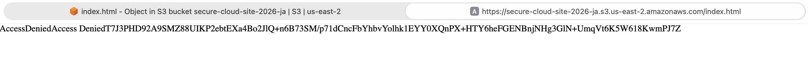
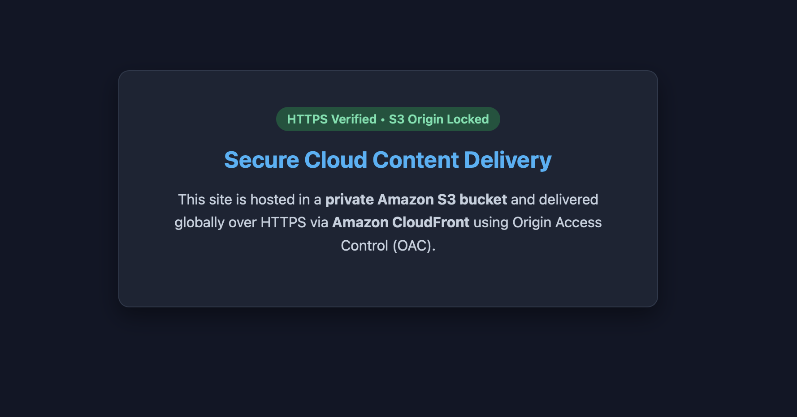

# Secure Cloud Content Delivery (Amazon CloudFront + Private S3 with OAC)

A cloud security and content delivery project built on AWS using **Amazon S3** and **Amazon CloudFront** with **Origin Access Control (OAC)**. Designed to serve static web content globally over HTTPS while keeping the underlying S3 bucket 100% private and inaccessible from the public internet.

## How It Works
1. **Private Origin (`Amazon S3`):** Static web files (`index.html`) are stored in a private S3 bucket (`secure-cloud-site-2026-ja`) with **Block all public access** enabled.
2. **Global HTTPS Delivery (`Amazon CloudFront`):** A CloudFront distribution sits in front of the bucket, enforcing HTTPS and caching content at edge locations on the $0/month Free flat-rate plan with security protections enabled.
3. **Least-Privilege Access (`Origin Access Control`):** An automated S3 bucket policy restricts `s3:GetObject` permissions strictly to the specific CloudFront distribution ARN—blocking all direct S3 URL requests.

## AWS Services Used
- **Amazon S3** (Private object storage with Block Public Access enabled)
- **Amazon CloudFront** (Global CDN, HTTPS/TLS termination, and Origin Access Control)
- **AWS WAF / Security Protections** (Enabled under the CloudFront Free flat-rate plan)

## Security & Verification Results
- **Direct S3 Access Blocked:** Navigating directly to the S3 Object URL (`https://secure-cloud-site-2026-ja.s3.us-east-2.amazonaws.com/index.html`) returned an XML **`AccessDenied`** error, confirming the bucket cannot be bypassed.
- **CloudFront HTTPS Delivery Verified:** Navigating to the CloudFront Distribution Domain Name loaded `index.html` cleanly over HTTPS.

## Proof of Execution

### Direct S3 URL Blocked (`AccessDenied`)

### Live HTTPS Delivery via CloudFront

